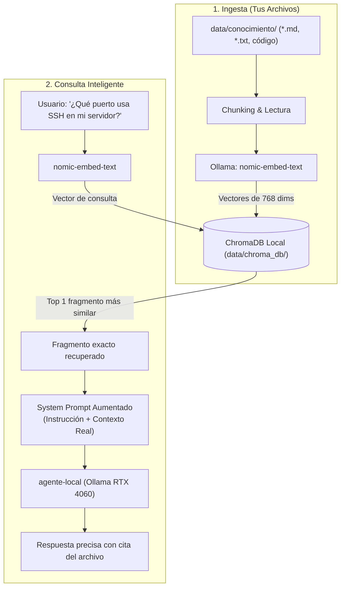

# 🧠 Arquitectura RAG Local (ChromaDB + Ollama)

## Ventajas de este diseño
1. **100% Privado**: Tus archivos nunca salen de tu ordenador. Los embeddings y el modelo corren en local.
2. **Cero alucinaciones**: El modelo responde basándose en el fragmento recuperado de tu disco.
3. **Persistente**: ChromaDB guarda los índices en `data/chroma_db/`. No hay que reindexar todo cada vez.
