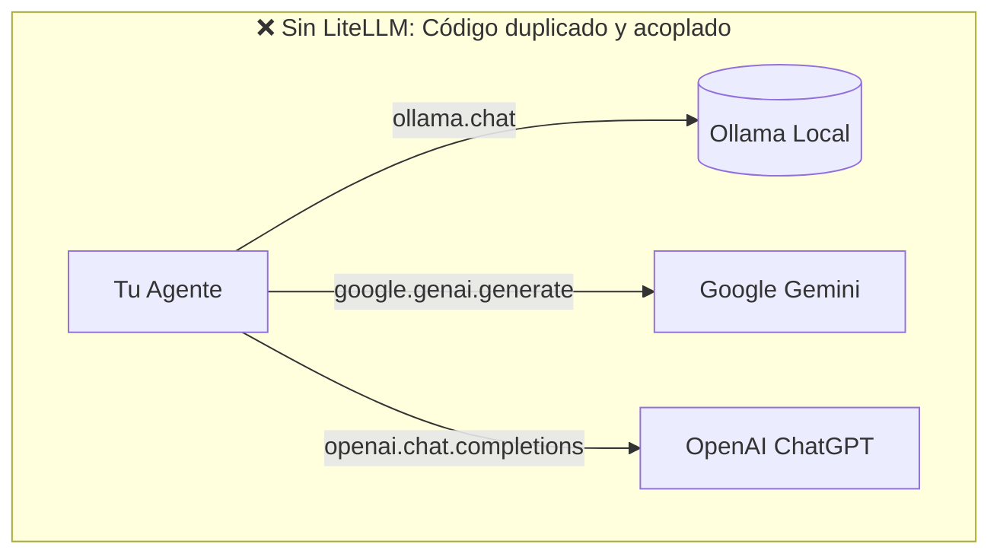
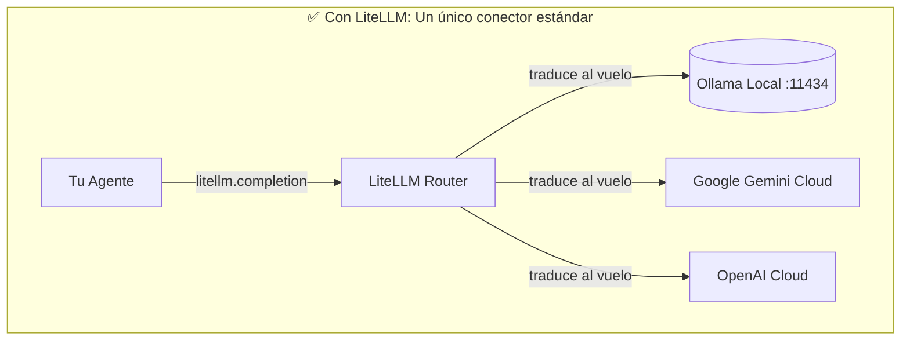

# 🧭 Entendiendo LiteLLM a fondo

## 1. El problema que resuelve

Cada proveedor de IA inventó su propia API con nombres de métodos y formatos de JSON incompatibles:

Si cambias de modelo, tienes que reescribir la lógica de mensajes, el streaming, el manejo de errores y las herramientas.

Tu código **solo aprende a hablar el estándar de OpenAI** (`messages=[{'role': 'user', 'content': ...}]`). LiteLLM se encarga de convertirlo al formato que cada empresa exija.

---

## 2. ¿Dónde vive LiteLLM y cómo funciona?

- **No es un programa ejecutable externo**: No tienes que instalarlo con un instalador de Windows.
- **Vive dentro de tu entorno virtual**: Está en `c:\desarrollo\ia-local\.venv\Lib\site-packages\litellm`.
- **Es código Python puro**: Cuando haces `import litellm`, lo que hace por dentro es instanciar clientes HTTP (`httpx`) dirigidos a la dirección correcta según el prefijo del modelo:
  - Si el modelo empieza por `ollama/...` ➡️ envía un POST HTTP a `http://localhost:11434/api/chat`.
  - Si el modelo empieza por `gemini/...` ➡️ envía un POST HTTPS a `https://generativelanguage.googleapis.com/...` usando tu `GEMINI_API_KEY`.
  - Si el modelo empieza por `gpt-...` ➡️ envía un POST HTTPS a `https://api.openai.com/...` usando tu `OPENAI_API_KEY`.

---

## 3. Sus dos modos de funcionamiento

| Modo | Cómo se usa | Para qué sirve |
| :--- | :--- | :--- |
| **1. Modo Librería** *(el que estamos usando)* | `import litellm` `litellm.completion(...)` | Para escribir scripts de Python y construir la lógica interna de tu Agente. |
| **2. Modo Proxy Server** | `litellm --config config/litellm.yaml --port 4000` | Levanta un servidor web local en el puerto 4000 que **finge ser OpenAI**. Cualquier app existente (Open WebUI, extensiones de VS Code) se conecta ahí creyendo que habla con ChatGPT, pero tú decides si responde tu GPU o Gemini. |

---

## 4. Por qué se quedaba "colgado" en tu terminal

Cuando Google devuelve un error temporal de sobrecarga (`503 Service Unavailable`), LiteLLM activa el sistema de reintentos con **enfriamiento exponencial**:
1. Intento 1: Google dice "ocupado".
2. LiteLLM espera callado 2 segundos.
3. Intento 2: Google sigue saturado.
4. LiteLLM espera callado 4 segundos.
5. Intento 3: espera 8 segundos...

Al no tener un mensaje de aviso ni un límite de tiempo (`timeout`), en la terminal parece que el programa se ha quedado congelado, cuando en realidad estaba esperando pacientemente a que los servidores de Google se descongestionaran.

Añadiendo `timeout=15` y mensajes explicativos, si Google tarda más de la cuenta, la terminal te avisa de inmediato sin dejarte esperando.
