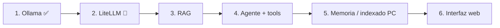

# 🗺️ Roadmap: Agente Personal Local

## Fase 0 — Limpieza y repositorio ✅
- [x] Proyecto limpio y nueva estructura
- [x] Repositorio en GitHub sincronizado

## Fase 1 — Ollama a fondo ✅
- [x] CLI: `run`, `pull`, `list`, `ps`, `show`, `rm`
- [x] API REST (`/api/generate`, `/api/chat`, `/api/embed`) y cliente Python
- [x] Parámetros: `temperature`, `num_ctx`, `top_p`, `seed`
- [x] Cuantizaciones y control de VRAM en RTX 4060 (8 GB)
- [x] Embeddings locales con `nomic-embed-text`
- [x] `Modelfile`: modelo personalizado `agente-local` registrado y operativo

## Fase 2 — LiteLLM (En curso 🔄)
- [x] Instalación de `litellm[proxy]` y cliente estándar `openai`
- [x] Configuración centralizada `config/litellm.yaml`
- [ ] Conector unificado en Python (`labs/02_litellm/01_completions_unificadas.py`)
- [ ] Configuración opcional de APIs en la nube (`GEMINI_API_KEY`, `OPENAI_API_KEY`)
- [ ] Servidor Proxy local (puerto 4000) para conectar cualquier cliente OpenAI a Ollama

## Fase 3 — RAG
- [ ] Embeddings locales y base vectorial (ChromaDB)
- [ ] Ingesta de documentos (PDF, Markdown, código)
- [ ] Colecciones específicas (proyectos, documentos personales, notas)

## Fase 4 — Agente con herramientas
- [ ] Bucle de agente multi-paso (ReAct)
- [ ] Herramientas: ficheros, shell (con confirmación), git, RAG, transcripción
- [ ] Seguridad: lista blanca de carpetas, registro de acciones

## Fase 5 — Memoria e indexado del ordenador
- [ ] Indexado incremental de carpetas del PC
- [ ] Memoria a largo plazo y perfil de usuario

## Fase 6 — Interfaz web
- [ ] API (FastAPI) + interfaz web interactiva
- [ ] Acceso remoto seguro (Tailscale / Cloudflare Tunnel)
- [ ] Tareas programadas
