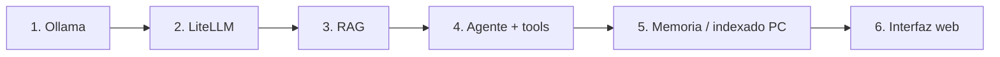

# 🗺️ Roadmap

## Fase 0 — Limpieza y repositorio ✅
- [x] Proyecto limpio y nueva estructura
- [x] Repositorio en GitHub

## Fase 1 — Ollama a fondo
- [ ] CLI: `run`, `pull`, `list`, `ps`, `show`, `rm`
- [ ] API REST (`/api/generate`, `/api/chat`, `/api/embed`) y cliente Python
- [ ] Parámetros: `temperature`, `num_ctx`, `top_p`, `seed`
- [ ] Cuantizaciones y cómo elegir modelo para 8 GB VRAM
- [ ] `Modelfile`: crear un modelo personalizado con system prompt propio
- [ ] Modelos de visión, de código y de embeddings
- [ ] Benchmark de velocidad de los modelos elegidos

## Fase 2 — LiteLLM
- [ ] Proxy compatible con OpenAI delante de Ollama
- [ ] Añadir Gemini y OpenAI vía API key
- [ ] Alias de modelos, fallbacks y control de gasto

## Fase 3 — RAG
- [ ] Embeddings locales y base vectorial
- [ ] Ingesta de documentos (PDF, Markdown, código)
- [ ] Colecciones específicas (proyectos, documentos personales, notas)
- [ ] Evaluación de calidad de respuestas

## Fase 4 — Agente con herramientas
- [ ] Bucle de agente multi-paso
- [ ] Herramientas: ficheros, shell (con confirmación), git, RAG, transcripción, web
- [ ] Seguridad: lista blanca de carpetas, registro de acciones

## Fase 5 — Memoria e indexado del ordenador
- [ ] Indexado incremental de carpetas
- [ ] Memoria a largo plazo y perfil de usuario

## Fase 6 — Interfaz web
- [ ] API (FastAPI) + interfaz web
- [ ] Acceso desde la red local y desde fuera (de forma segura)
- [ ] Tareas programadas
